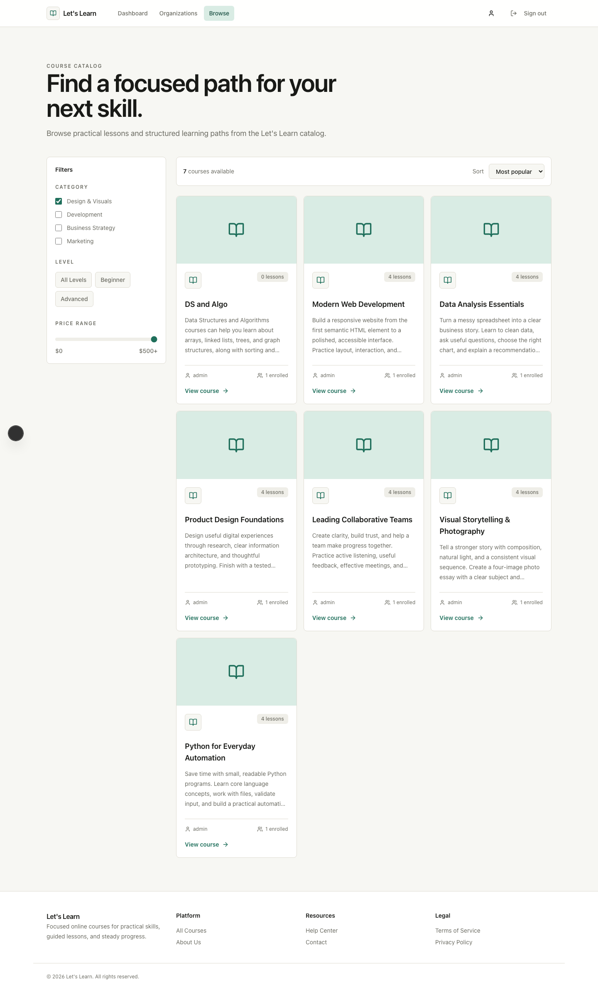
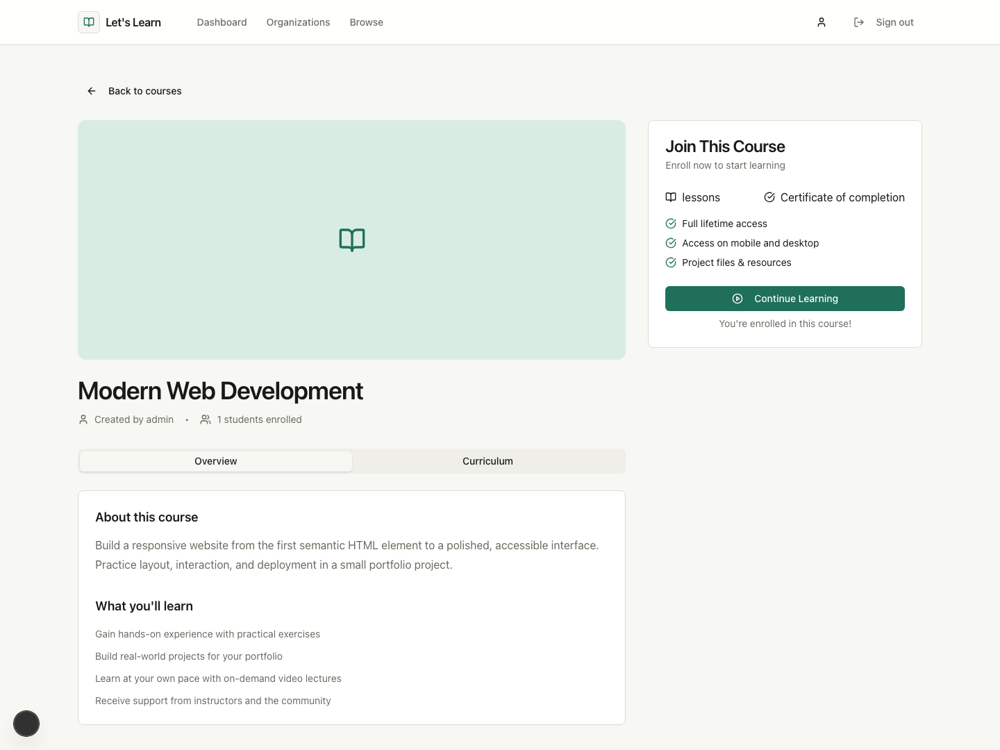
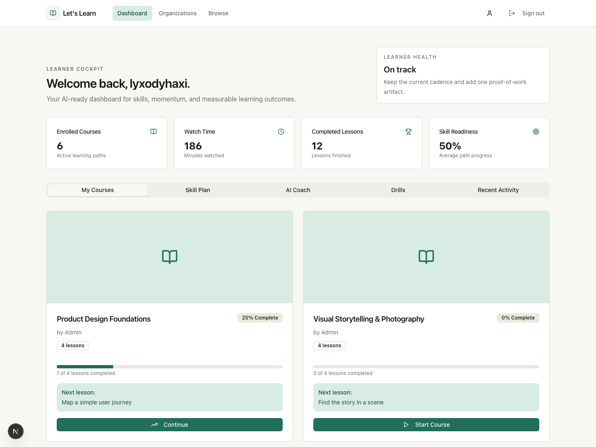
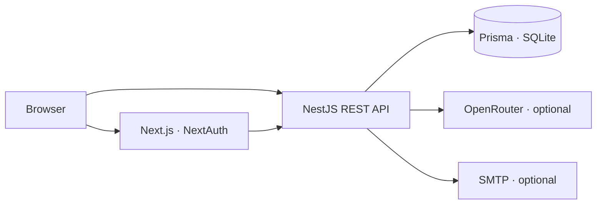

# Let's Learn

A learning management system for self-paced courses and organization training. Built with Next.js, NestJS, Prisma, and SQLite, Let's Learn brings course delivery, progress tracking, assessments, and completion certificates into one application.


## Capabilities

| Area | Features |
| --- | --- |
| Learning | Public course catalog, course overviews, ordered lessons, enrollment, and lesson completion |
| Learner dashboard | Course progress, recorded watch time, next lessons, skill suggestions, and recall exercises |
| Study coach | Authenticated, course-aware coaching through OpenRouter; requires an API key |
| Administration | User, course, and lesson management with role-based access |
| Organizations | Academic and Professional workspaces with organization-scoped memberships and optional modules |
| Team training | Departments, teams, manager assignments, deadlines, and progress reports with CSV export |
| Assessments | Course quizzes, pass thresholds, attempt limits, and assignment-time content snapshots |
| Credentials | Completion records, certificate views, expiry, and renewal cycles |
| Notifications | In-app reminders and optional SMTP delivery with retry tracking |

The public Academic catalog and organization training use separate workflows. Private organization courses are excluded from public catalog responses. Skill suggestions and learner-health indicators are application heuristics; the study coach is the feature that calls an external AI service.

## Product tour

The screenshots below were captured from the running application using the existing `lyxodyhaxi` account. Course enrollments, completion history, watch time, and the certificate are illustrative sample data.

### Course catalog

Browse administrator-authored courses with locally stored Unsplash cover images, descriptions, lesson counts, and enrollment totals.



### Course overview

Review a course description and curriculum, then enroll or continue learning.



### Lesson workspace

Read lesson material, navigate the curriculum, and track completed lessons.



## Architecture



| Layer | Main technologies |
| --- | --- |
| Frontend | Next.js 15, React 19, TypeScript, Tailwind CSS 4, Radix UI |
| Authentication | NextAuth credentials sessions, Passport JWT, bcrypt |
| Backend | NestJS 11, TypeScript, Swagger/OpenAPI |
| Persistence | Prisma 6.5 and SQLite |
| Verification | Jest, Supertest, Playwright |

```text
backend/
  prisma/              Schema, migrations, and local database
  scripts/             Administrator setup and sample-data utilities
  src/                 API modules, authentication, and organization training
  test/                Integration and migration tests
frontend/
  app/                 App Router pages and authentication routes
  components/          Learner, admin, and organization interfaces
  lib/                 API clients and shared application logic
  public/images/       Local sample course photography
  scripts/             Browser screenshot workflows
docs/
  screenshots/         Screenshots embedded in this README
  image-credits.md     Unsplash image sources
```

## Local setup

### Requirements

- Node.js **22**; the repository's `.nvmrc` selects the supported version.
- npm for the backend and pnpm for the frontend.
- Python 3 for the SQLite migration integration tests.
- An OpenRouter API key for live study-coach responses; other learning features work without it.

Use a Node binary matching your machine's architecture. If native dependencies were installed with a different architecture, reinstall them under the supported Node runtime.

### Install and configure

From the repository root:

```bash
nvm use
cp backend/.env.example backend/.env
cp frontend/.env.example frontend/.env.local

cd backend
npm install
npx prisma generate
npm run db:migrate

cd ../frontend
pnpm install
```

Copy environment examples only when creating new configuration files; retain existing local settings on an established checkout.

| File | Setting | Purpose |
| --- | --- | --- |
| `backend/.env` | `PORT=3001` | API listening port |
| `backend/.env` | `FRONTEND_URL=http://localhost:3000` | Allowed frontend origin and invitation-link base |
| `backend/.env` | `JWT_SECRET` | Signing secret for API access tokens |
| `backend/.env` | `OPENROUTER_API_KEY` | Optional study-coach provider key |
| `backend/.env` | `OPENROUTER_MODEL=openrouter/auto` | Model requested by the study coach |
| `frontend/.env.local` | `NEXT_PUBLIC_API_URL=http://localhost:3001` | API base URL used by the frontend |
| `frontend/.env.local` | `NEXTAUTH_URL=http://localhost:3000` | Frontend authentication URL |
| `frontend/.env.local` | `NEXTAUTH_SECRET` | Encryption/signing secret for frontend sessions |

Set your own authentication secrets. Keep credentials in local environment files or your deployment's secret store.

### Start the application

Run each process in a separate terminal:

```bash
# Terminal 1
cd backend
npm run start:dev
```

```bash
# Terminal 2
cd frontend
pnpm dev
```

| Service | Local address |
| --- | --- |
| Application | http://localhost:3000 |
| Backend | http://localhost:3001 |
| Swagger API reference | http://localhost:3001/api |

Backend npm startup commands apply pending migrations before starting NestJS and stop if migration fails. After a schema change, regenerate the Prisma client and restart any already-running backend process.

### Create the first administrator

Register a learner through `/auth/signup`. For administration, set `ADMIN_EMAIL`, `ADMIN_USERNAME`, and `ADMIN_PASSWORD` in your shell, then run:

```bash
cd backend
npm run admin:create
```

The password must contain at least 12 characters. The utility creates a new administrator and refuses to overwrite an existing account. There are no shared default administrator credentials.

## Sample learning data

The sample utility requires an existing learner account and an existing platform administrator. It creates six free courses under the administrator account, adds four text lessons to each course, enrolls the learner, and records sample completion activity through the application's progress service.

```bash
cd backend
npm run seed:sample -- lyxodyhaxi
```

| Course | Seeded completion |
| --- | --- |
| Modern Web Development | 2 of 4 lessons · 50% |
| Data Analysis Essentials | 4 of 4 lessons · 100% |
| Product Design Foundations | 1 of 4 lessons · 25% |
| Leading Collaborative Teams | 3 of 4 lessons · 75% |
| Visual Storytelling & Photography | 0 of 4 lessons · 0% |
| Python for Everyday Automation | 2 of 4 lessons · 50% |

The initial sample produces 12 completed lessons, 186 minutes of recorded activity, and one completion certificate. Re-running it reuses the sample courses and lessons and preserves existing learner progress and account credentials. Pass another existing username to populate that account instead. Run this utility against a development database: the course content and completion records are demonstrations, not verified training.

Sample covers are downloaded from Unsplash and served from `frontend/public/images/courses`, so the demo does not depend on live image requests. See [image credits](docs/image-credits.md) for the original sources. Administrators can also supply a remote cover URL when creating a course.

### Refresh the README screenshots

Start the populated backend and frontend first, then run:

```bash
cd frontend
pnpm screenshots:readme lyxodyhaxi
```

Playwright Chromium must be installed (`pnpm exec playwright install chromium`). This local-only utility reads the configured development database and creates a temporary authenticated browser session for the selected account without changing its password. It captures real pages and API responses, checks images and completion states, and checks mobile overflow. Browser sessions are discarded when the run completes; no credentials or session files are written to the documentation directory.

## Organization training

Sign in and open `/organizations` to access workspaces. Platform administrators create organizations; organization permissions then depend on active memberships and enabled modules.

- **Academic:** public learning and course completion.
- **Professional:** organization-specific training, teams, assessments, certifications, reminders, and reporting.
- **Organization administrators:** configure modules, invite members, organize departments and teams, and review delivery status.
- **Instructors:** publish course content and quizzes.
- **Managers:** assign training and view members of their managed teams.
- **Learners:** complete assigned lessons, submit quizzes, and view credentials.

Assignments snapshot lesson content, quiz questions, pass thresholds, and certification policies. Course edits affect future assignments. Assigning a team captures its current active members; assign again to include later joiners. Reassigning an active course preserves progress. Cancelling an assignment retains its history and stops future renewal cycles.

Credentials retain issuance history. Renewal opens 30 days before expiry; early renewal extends the previous expiry and late renewal starts from the new completion date. Month-end calculations clamp to the target month's last day. Reporting distinguishes training completion from credential validity.

### Workers and email

`TRAINING_WORKER_ENABLED=true` enables the one-minute training worker. Use one worker-enabled replica for the current SQLite deployment. Reminders cover upcoming deadlines and weekly overdue windows; renewal reminders include the 30-day renewal window. Only the current window is queued after downtime.

Email is optional and disabled by default. Configure these backend settings to enable delivery:

| Setting | Purpose |
| --- | --- |
| `EMAIL_ENABLED=true` | Enable SMTP delivery |
| `SMTP_HOST`, `SMTP_PORT` | SMTP server; default port is 587 |
| `SMTP_FROM` | Sender address |
| `SMTP_USER`, `SMTP_PASSWORD` | Credentials, if required by the server |
| `SMTP_REQUIRE_TLS=true` | Require STARTTLS on ports other than 465 |

Port 465 uses implicit TLS. Set `SMTP_REQUIRE_TLS=false` only for a local test server. In-app reminders and invitation links work without SMTP. Failed deliveries retry up to five times with exponential delays and are visible in **Settings → Email delivery**. Messages created while email is disabled are not sent retroactively. Delivery is at least once: a process failure after SMTP acceptance can cause a duplicate email, with the same stable Message-ID.

## API reference

Interactive request schemas and authentication details are available at `/api` while the backend is running.

| Area | Routes |
| --- | --- |
| Authentication | `POST /auth/register`, `POST /auth/login` |
| Courses and lessons | `/courses`, `/courses/:id`, `/lessons` |
| Enrollments | `/enrollments`, `/enrollments/my-courses` |
| Lesson progress | `/progress/video/:courseId`, `PUT /progress/video` |
| AI study coach | `POST /ai/study-coach` |
| Platform administration | `/admin/dashboard`, `/admin/users`, `/admin/courses`, `/admin/lessons` |
| Organization training | `/organizations/:organizationId` and its course, team, training, report, and credential resources |

Protected API requests use `Authorization: Bearer <access_token>`. Organization endpoints additionally enforce membership, role, and module checks.

## Verification

```bash
cd backend
npm test -- --runInBand
npm run test:e2e -- --runInBand --watchman=false
npm run build

cd ../frontend
pnpm build
```

Integration tests use temporary databases and cover migrations, organization isolation, invitations, grading, renewal, reminders, and CSV export. They do not modify the development database or send live email. The screenshot workflow provides additional checks against the populated local application.

## Deployment

1. Build both applications with Node 22 and install dependencies for the deployment's CPU architecture.
2. Configure `JWT_SECRET`, `NEXTAUTH_SECRET`, frontend/API URLs, and optional provider credentials.
3. Persist and back up `backend/prisma/dev.db`; the current Prisma schema uses that SQLite file directly.
4. Run `npx prisma generate` and `npm run db:migrate` from `backend`. Keep the Prisma CLI available if using the npm startup migration hooks.
5. Run `npm run start:prod` in `backend` and `pnpm start` in `frontend`, behind your HTTPS reverse proxy.
6. Enable the training worker on one replica and verify SMTP in a staging mailbox before enabling email.

The organization migration moves existing learning into **Academic Learning**, preserves courses, enrollments, and video progress, and maps existing roles to memberships. Historical certificates use lesson-completion evidence and retain an unknown issue date rather than inventing one. Back up an established database before applying migrations.

SQLite is the current deployment model; shared-database multi-replica operation requires further infrastructure work. Subscription billing and external accreditation are outside the implemented feature set.
